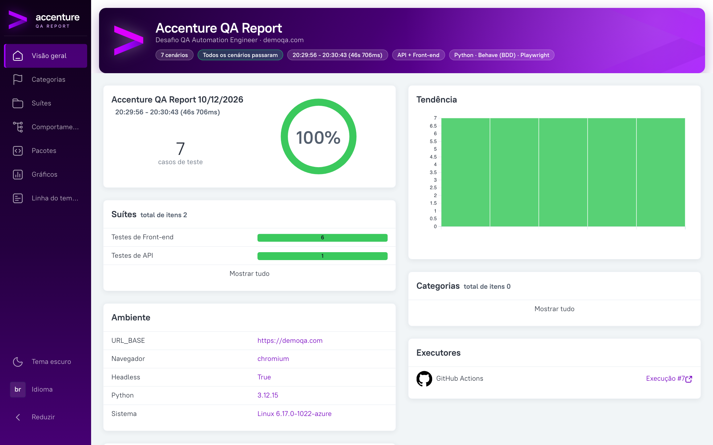
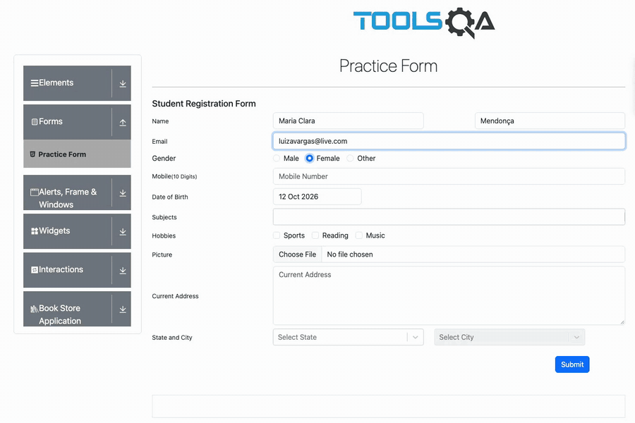
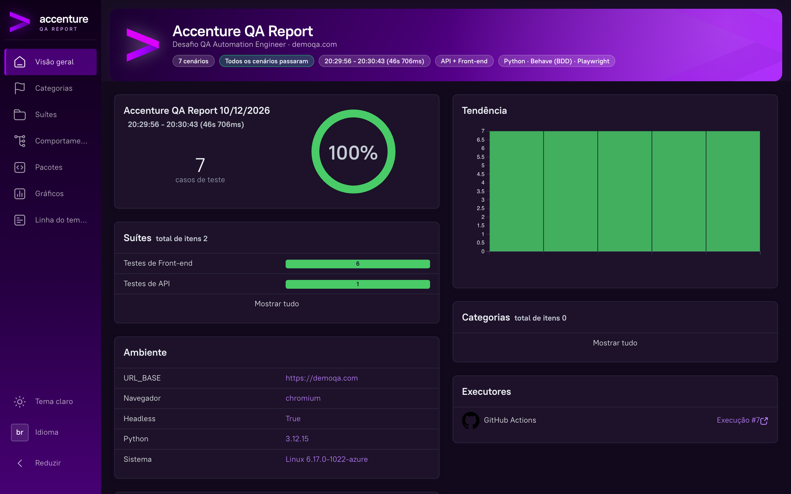
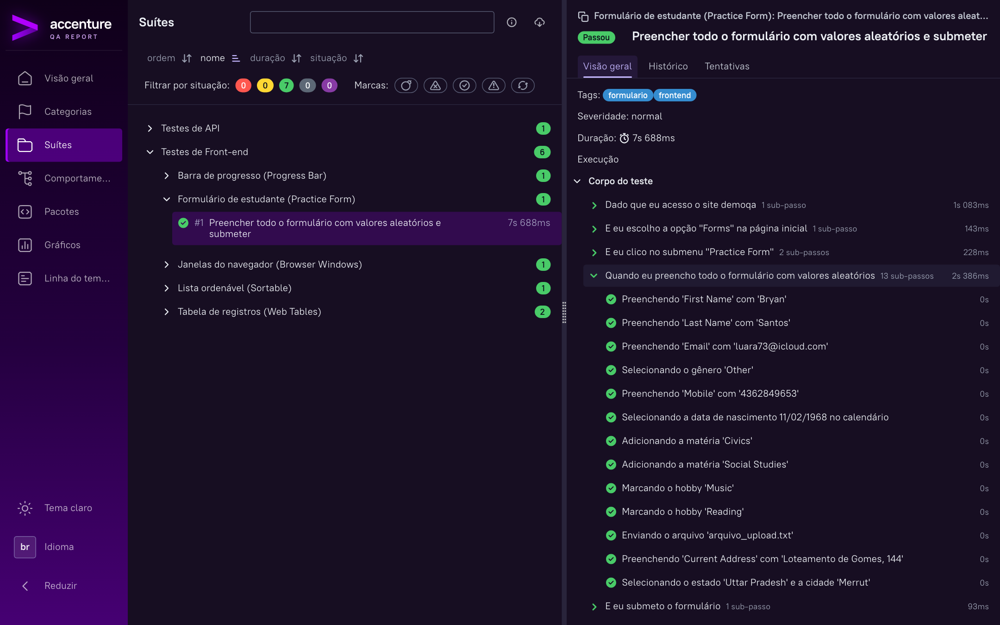
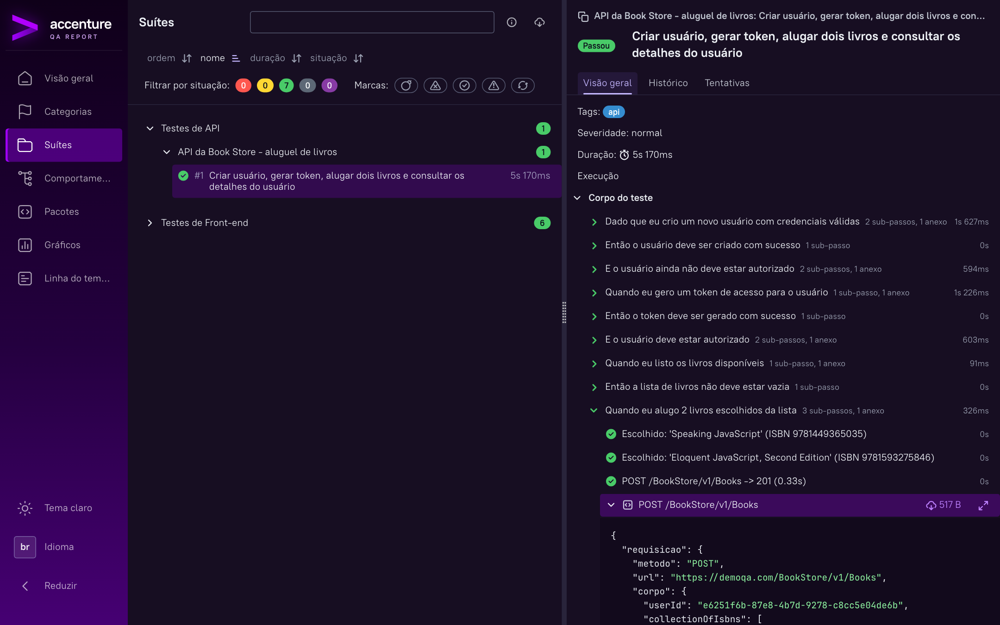
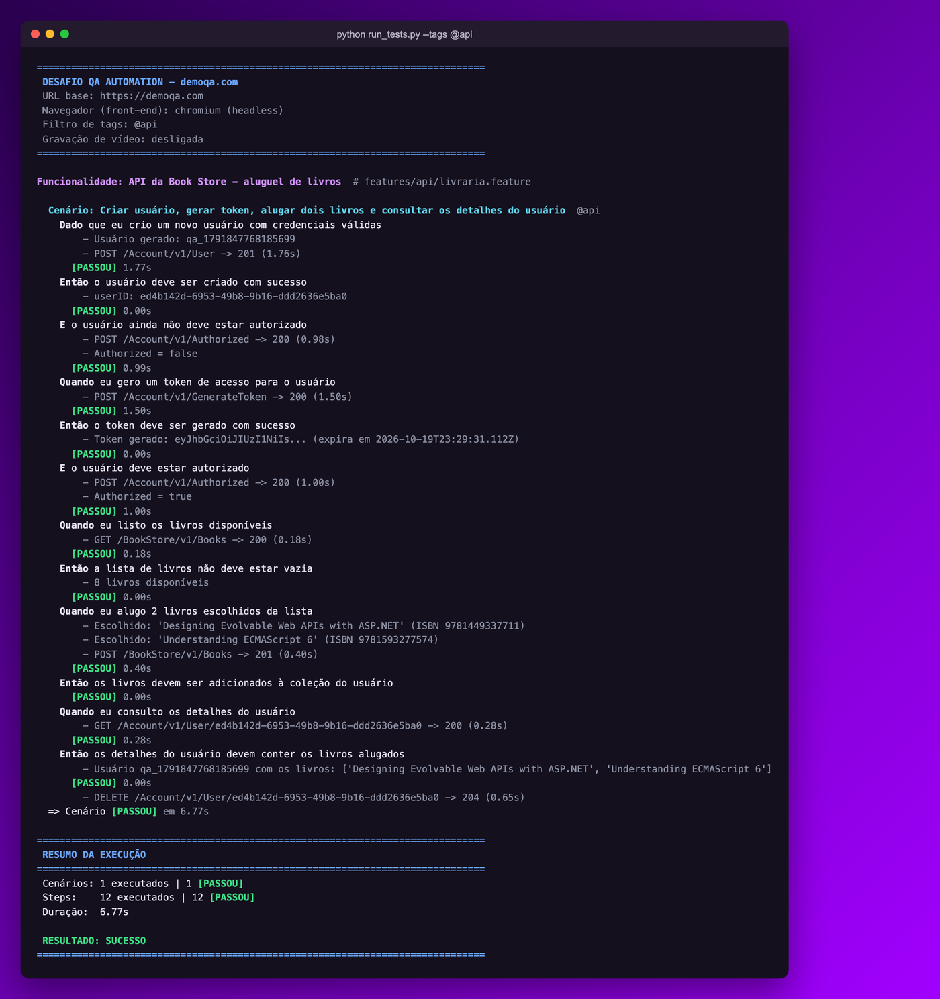
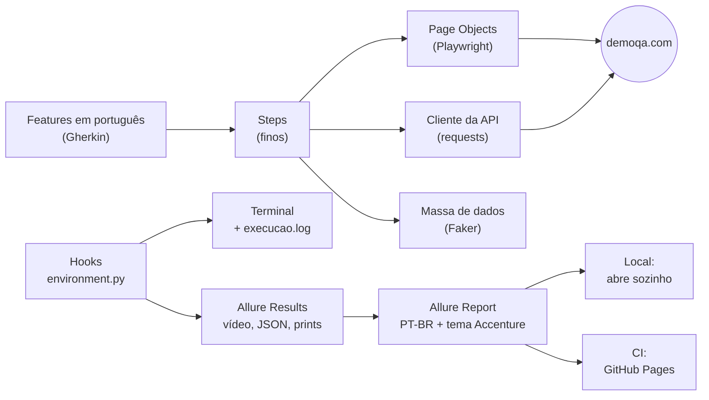

<div align="center">


# Desafio QA Automation Engineer

**Automação de API e Front-end do [demoqa.com](https://demoqa.com) com BDD em português,<br>relatório Allure com a identidade da Accenture e publicação automática a cada push.**

[](https://github.com/danilomedeiros100/desafio-qa-accenture/actions/workflows/tests.yml)
[](https://danilomedeiros100.github.io/desafio-qa-accenture/)

-23D96C?logo=cucumber&logoColor=white)


### [Ver o relatório ao vivo](https://danilomedeiros100.github.io/desafio-qa-accenture/) · [Execuções no GitHub Actions](https://github.com/danilomedeiros100/desafio-qa-accenture/actions/workflows/tests.yml) · [Rodar em 1 comando](#rodando-em-1-comando)

<sub>Depois de clonar, abra o <a href="README.html"><code>README.html</code></a> no navegador (dois cliques, sem servidor) para ver a apresentação visual do projeto.</sub>



</div>

---

## Destaques

| | |
|---|---|
| **Desafio 100% coberto, com o bônus** | Parte 1 (API) e todos os 5 fluxos da Parte 2 (Front-end), incluindo os 12 registros dinâmicos via Gherkin: **7 cenários, 63 steps** |
| **Um único comando** | `python run_tests.py` executa tudo, gera o relatório e **já abre no navegador**. Igual no Linux, macOS e Windows, e com botões prontos no PyCharm |
| **Allure com a cara da Accenture** | Em português, com logo, cores da marca e faixa de resumo. Testes separados em **API** e **Front-end** |
| **Relatório publicado a cada push** | O GitHub Actions roda tudo e publica no [GitHub Pages](https://danilomedeiros100.github.io/desafio-qa-accenture/), com histórico de tendência e link para a execução |
| **Evidência de tudo** | **Vídeo** de cada cenário de front, screenshot da tela final, **requisição e resposta em JSON** de cada chamada da API, trace do Playwright em falhas |
| **Execução legível no terminal** | Cada step aparece em tempo real com o que foi feito (cliques, campos, chamadas HTTP com status e tempo), mais um log limpo salvo em arquivo |
| **Código organizado** | BDD em português, Page Objects, cliente de API, massa de dados aleatória (Faker) e steps finos |
| **Estável de verdade** | Anúncios bloqueados, esperas inteligentes e três comportamentos instáveis do demoqa identificados, tratados e documentados |

## Veja rodando

<div align="center">

<br><sub>Gravação real da automação: formulário preenchido com dados aleatórios, popup validado campo a campo e lista ordenada com drag and drop.</sub>
</div>

## Rodando em 1 comando

Com Python 3.10+ instalado ([detalhes por sistema operacional](#instalação)):

```bash
git clone https://github.com/danilomedeiros100/desafio-qa-accenture.git
cd desafio-qa-accenture
python -m venv .venv && source .venv/bin/activate      # Windows: .\.venv\Scripts\Activate.ps1
pip install -r requirements.txt && python -m playwright install chromium

python run_tests.py
```

Pronto: os testes de API e Front-end rodam, o resumo aparece no terminal e o **Accenture QA Report abre sozinho no navegador**.

| Quero... | Comando |
|---|---|
| Rodar tudo e abrir o relatório | `python run_tests.py` |
| Ver o navegador executando | `python run_tests.py --visivel` |
| Só os testes de API | `python run_tests.py --tags @api` |
| Só os testes de Front-end | `python run_tests.py --tags @frontend` |
| Gravar vídeo de cada cenário | `python run_tests.py --video` |
| Reabrir o relatório da última execução | `python run_tests.py --somente-relatorio` |

> O relatório local precisa do Allure CLI ([instalação](#instalação)). Sem ele, os testes rodam normalmente e o script só avisa. O relatório publicado no GitHub Pages não precisa de nada instalado.

**No PyCharm**, as configurações já vêm prontas no projeto: escolha **"1 - Todos os testes + Allure"** no seletor do canto superior direito e clique em Run.

## O relatório

Publicado a cada push em **https://danilomedeiros100.github.io/desafio-qa-accenture/**

<table>
<tr>
<td width="50%"><br><sub><b>Visão geral (tema escuro):</b> resumo da execução, suítes por tipo de teste, ambiente e executor do CI. O tema claro é o padrão; o escuro fica a um clique.</sub></td>
<td width="50%"><br><sub><b>Cenário de front-end:</b> cada step com as ações executadas, screenshot e vídeo da execução.</sub></td>
</tr>
<tr>
<td colspan="2"><br><sub><b>Cenário de API:</b> cada chamada HTTP anexada com requisição e resposta em JSON (senha mascarada).</sub></td>
</tr>
</table>

O que o relatório entrega:

- **Português** e **tema claro** por padrão, com **identidade Accenture**: título "Accenture QA Report", ícone na aba do navegador, logo no menu, faixa de resumo e paleta roxa (também no tema escuro);
- **Categorização API × Front-end** nas abas Suítes e Comportamentos e no widget da Visão geral;
- **Evidências** por cenário: vídeo, screenshot, JSON das chamadas de API, trace do Playwright em falhas;
- **Categorias de falha** em português (validação, timeout, erro de automação) e dados do ambiente;
- No CI: **histórico de tendência** entre execuções e **link para a execução** do GitHub Actions.

## A execução no terminal

<div align="center">

</div>

Tudo em tempo real e em português: cenário, cada step com resultado e tempo, as ações dentro do step (no front: cliques, campos preenchidos, valores sorteados, arrastos do drag and drop) e um resumo final. Uma cópia sem cores fica em `reports/execucao.log` para leitura e anexos.

## Cobertura do desafio

| Enunciado | Cenário | Destaque |
|---|---|---|
| **API:** criar usuário, gerar token, confirmar autorização, listar livros, alugar 2 livros, consultar usuário | [`livraria.feature`](features/api/livraria.feature) | Uma única execução contínua; valida também que o usuário **não** está autorizado antes do token; remove o usuário no final |
| **Practice Form:** preencher tudo com valores aleatórios, upload de `.txt` versionado, submeter, validar e fechar o popup | [`formulario_estudante.feature`](features/frontend/formulario_estudante.feature) | Confere **cada campo** exibido no popup contra o que foi enviado |
| **Browser Windows:** abrir nova janela, validar "This is a sample page", fechar | [`janelas_navegador.feature`](features/frontend/janelas_navegador.feature) | Garante que só a janela original continua aberta |
| **Web Tables:** criar, editar e deletar um registro | [`tabelas_web.feature`](features/frontend/tabelas_web.feature) | Valida os dados novos e a ausência dos antigos |
| **Web Tables (bônus):** criar 12 registros dinamicamente pelo Cucumber e deletar todos | [`tabelas_web.feature`](features/frontend/tabelas_web.feature) `@bonus` | Quantidade vem do Gherkin; confirma que os registros originais continuam intactos |
| **Progress Bar:** parar antes de 25%, validar `<= 25%`, completar 100% e resetar | [`barra_progresso.feature`](features/frontend/barra_progresso.feature) | Polling dentro do navegador, sem condição de corrida |
| **Sortable:** ordenar em ordem crescente com drag and drop | [`lista_ordenavel.feature`](features/frontend/lista_ordenavel.feature) | A lista já carrega ordenada, então o teste **embaralha antes** para provar a ordenação |

Critérios do enunciado: **BDD com Cucumber** (Behave é o Cucumber do Python, com Gherkin em português), **Page Objects**, código organizado e **versionado no GitHub**.

## Como funciona



---

## Documentação completa

- [Estrutura do projeto](#estrutura-do-projeto)
- [Instalação](#instalação) ([Linux](#linux) · [macOS](#macos) · [Windows](#windows))
- [Todas as formas de executar](#todas-as-formas-de-executar)
- [Allure Report em detalhes](#allure-report-em-detalhes)
- [Variáveis de ambiente](#variáveis-de-ambiente)
- [Evidências geradas](#evidências-geradas)
- [CI (GitHub Actions)](#ci-github-actions)
- [Decisões técnicas](#decisões-técnicas)
- [Problemas comuns](#problemas-comuns)

### Estrutura do projeto

Arquivos e pastas seguem a convenção em inglês (`pages`, `steps`, `factories`). Classes, métodos, variáveis, features e steps estão em português.

```
.
├── desafio_qa/                     # código de automação (reutilizável)
│   ├── config.py                   # URLs, navegador, timeouts, vídeo (via variáveis de ambiente)
│   ├── api/
│   │   └── bookstore_client.py     # ClienteBookStore: criar_usuario, gerar_token, alugar_livros...
│   ├── data/
│   │   └── factories.py            # massa aleatória: novo_usuario_api, novo_estudante, novo_funcionario
│   ├── pages/                      # Page Objects
│   │   ├── base_page.py            # PaginaBase: abrir, clicar_com_seguranca
│   │   ├── home_page.py            # PaginaInicial (escolher_card) e MenuLateral (clicar_item)
│   │   ├── practice_form_page.py   # PaginaFormularioPratica: preencher, submeter, fechar_popup...
│   │   ├── browser_windows_page.py # PaginaJanelasNavegador: abrir_nova_janela
│   │   ├── web_tables_page.py      # PaginaTabelasWeb: adicionar/editar/excluir_registro...
│   │   ├── progress_bar_page.py    # PaginaBarraProgresso: iniciar, parar_ao_atingir, resetar...
│   │   └── sortable_page.py        # PaginaOrdenavel: embaralhar, ordenar_crescente...
│   └── support/
│       ├── terminal.py             # impressão da execução no terminal
│       ├── evidence.py             # anexos, categorização (API x Front-end) e ambiente do Allure
│       └── allure_branding.py      # aplica o tema Accenture no relatório gerado
├── features/
│   ├── api/livraria.feature
│   ├── frontend/*.feature
│   ├── steps/*_steps.py            # step definitions (finos: delegam aos Page Objects)
│   └── environment.py              # hooks: navegador, terminal, anúncios, evidências, limpeza
├── resources/
│   ├── upload/arquivo_upload.txt   # arquivo .txt usado no upload do formulário
│   └── allure/                     # tema Accenture do relatório (ícone SVG, CSS e JS)
├── docs/                           # enunciado do desafio e imagens deste README
├── run_tests.py                    # executa os testes e abre o Allure Report (qualquer SO/IDE)
├── .run/                           # configurações de execução do PyCharm
├── behave.ini                      # configuração do Behave (Allure como formatter padrão)
├── requirements.txt
├── Makefile                        # atalhos para Linux/macOS
└── .github/workflows/tests.yml     # pipeline de CI
```

### Instalação

| Ferramenta | Versão | Para quê |
|---|---|---|
| Python | 3.10 ou superior | executar os testes |
| Git | qualquer | clonar o repositório |
| Java (JRE/JDK) | 8 ou superior | apenas para gerar o Allure Report localmente |
| Allure CLI | 2.x | apenas para gerar o Allure Report localmente |

Os testes rodam sem Java e sem Allure CLI; eles só são necessários para **visualizar** o relatório na sua máquina.

```bash
git clone https://github.com/danilomedeiros100/desafio-qa-accenture.git
cd desafio-qa-accenture
```

#### Linux

```bash
python3 -m venv .venv
source .venv/bin/activate
pip install -r requirements.txt
python -m playwright install --with-deps chromium
```

> `--with-deps` instala as bibliotecas de sistema que o Chromium precisa (pode pedir `sudo`). Em Debian/Ubuntu, se o `venv` não existir: `sudo apt install python3-venv`.

Allure CLI (opcional, para o relatório local):

```bash
sudo apt install default-jre        # Java
# Opção 1 - pacote .deb oficial (troque a versão pela mais recente em github.com/allure-framework/allure2/releases)
wget https://github.com/allure-framework/allure2/releases/download/2.42.0/allure_2.42.0-1_all.deb
sudo dpkg -i allure_2.42.0-1_all.deb
# Opção 2 - via npm
npm install -g allure-commandline
```

#### macOS

```bash
python3 -m venv .venv
source .venv/bin/activate
pip install -r requirements.txt
python -m playwright install chromium
brew install allure     # opcional, para o relatório local (instala o Java se necessário)
```

Também é possível usar o `Makefile`: `make install`.

#### Windows

No **PowerShell**:

```powershell
py -3 -m venv .venv
.\.venv\Scripts\Activate.ps1
pip install -r requirements.txt
python -m playwright install chromium
```

> Se o PowerShell bloquear a ativação do venv, rode uma vez: `Set-ExecutionPolicy -Scope CurrentUser RemoteSigned`.
> No **Prompt de Comando (cmd)**, a ativação é `.venv\Scripts\activate.bat`.

Allure CLI (opcional), com [Scoop](https://scoop.sh) ou npm:

```powershell
scoop install allure          # requer Java: scoop bucket add java; scoop install openjdk
# ou
npm install -g allure-commandline
```

### Todas as formas de executar

#### `run_tests.py` (recomendado)

```bash
python run_tests.py                              # tudo (API + Front-end) + relatório
python run_tests.py --tags @api                  # só API
python run_tests.py --tags @frontend             # só Front-end
python run_tests.py --tags @frontend --visivel   # vendo o navegador executar
python run_tests.py --video                      # grava vídeo de cada cenário de front (vai para o Allure)
python run_tests.py --somente-relatorio          # só reabre o relatório da última execução
python run_tests.py --sem-relatorio              # só executa os testes
python run_tests.py --servidor                   # abre via 'allure open' (servidor local)
```

O script grava uma **cópia limpa do log**, sem códigos de cor, em `reports/execucao.log`. O código de saída é o do `behave` (diferente de 0 se algum teste falhar), então o script também serve para pipelines. Rode uma execução por vez, porque elas compartilham a pasta `reports/`.

#### PyCharm

As configurações da pasta [`.run/`](.run) aparecem no seletor de execução (canto superior direito):

| Configuração | O que faz |
|---|---|
| **1 - Todos os testes + Allure** | roda API + Front-end e abre o relatório |
| **2 - Testes de API + Allure** | só a Parte 1 |
| **3 - Testes de Front-end + Allure** | só a Parte 2 |
| **4 - Front-end com navegador visível** | Parte 2 com o navegador na tela |
| **4b - Todos os testes com navegador visível** | API + Front-end, com o navegador na tela |
| **5 - Abrir Allure Report (última execução)** | só gera e abre o relatório |

Antes, defina o interpretador do projeto como o `.venv` em *Settings > Project > Python Interpreter*. Se as configurações não aparecerem, crie uma manualmente: *Run > Edit Configurations > + > Python*, com **Script** = `run_tests.py`, **Working directory** = pasta do projeto e, em *Modify options*, marque *Emulate terminal in output console* (para as cores).

No **VS Code** e em outras IDEs, use o terminal integrado com o `.venv` ativado: `python run_tests.py`.

#### `behave` direto

```bash
behave                          # tudo (API + Frontend) numa única execução
behave --tags=@api              # só a Parte 1 (API)
behave --tags=@frontend         # só a Parte 2 (Frontend)
behave --tags=@bonus            # bônus dos 12 registros
behave --tags=@formulario       # um cenário específico
```

Tags disponíveis: `@api`, `@frontend`, `@formulario`, `@janelas`, `@tabelas_web`, `@bonus`, `@barra_progresso`, `@ordenavel`.

Para ver o navegador com o `behave` direto, defina as variáveis de ambiente:

| Terminal | Comando |
|---|---|
| Linux / macOS (bash, zsh) | `HEADLESS=false SLOW_MO=300 behave --tags=@frontend` |
| Windows PowerShell | `$env:HEADLESS="false"; $env:SLOW_MO="300"; behave --tags=@frontend` |
| Windows cmd | `set HEADLESS=false && set SLOW_MO=300 && behave --tags=@frontend` |

Atalhos do `Makefile` (Linux/macOS): `make run` (tudo + relatório), `make test`, `make api`, `make frontend`, `make bonus`, `make headed`, `make report`, `make allure`, `make allure-serve`, `make clean`.

### Allure Report em detalhes

Todo `behave` grava os resultados do Allure em `reports/allure-results` (o formatter do Allure é o padrão no `behave.ini`).

**Categorização API x Front-end:** os cenários são agrupados pelas tags `@api` e `@frontend`. Na aba Suítes aparecem `Testes de API` e `Testes de Front-end`, com as funcionalidades dentro de cada grupo. Na aba Comportamentos, o épico é o tipo de teste e a funcionalidade é a feature.

**Identidade visual:** o tema fica em [`resources/allure/`](resources/allure) (ícone SVG, CSS e JS) e é aplicado por [`allure_branding.py`](desafio_qa/support/allure_branding.py) depois do `allure generate`. O `run_tests.py` e o CI já fazem isso. As cores de status (passou, falhou) continuam as padrão, para não confundir a leitura.

**Gerar manualmente:**

```bash
allure generate reports/allure-results -o reports/allure-report --clean --lang br --name "Accenture QA Report" --single-file
python -m desafio_qa.support.allure_branding reports/allure-report
```

`allure serve reports/allure-results` também funciona, mas abre o relatório padrão (em inglês e sem o tema).

> O `run_tests.py` apaga os resultados anteriores a cada execução (use `--manter-resultados` para acumular). Rodando o `behave` direto, os resultados se acumulam; para limpar, apague a pasta `reports` (`make clean`, `Remove-Item -Recurse reports` no PowerShell ou `rmdir /s /q reports` no cmd).

### Variáveis de ambiente

| Variável | Padrão | Descrição |
|---|---|---|
| `BASE_URL` | `https://demoqa.com` | URL alvo |
| `BROWSER` | `chromium` | `chromium`, `firefox` ou `webkit` (instale com `python -m playwright install <navegador>`) |
| `HEADLESS` | `true` | `false` abre o navegador na tela |
| `SLOW_MO` | `0` | atraso (ms) entre ações do navegador |
| `RECORD_VIDEO` | `false` | `true` grava um vídeo de cada cenário de front-end e anexa ao Allure |
| `DEFAULT_TIMEOUT_MS` | `15000` | timeout padrão do Playwright |
| `API_TIMEOUT_S` | `30` | timeout das requisições da API |
| `NO_COLOR` | (vazio) | qualquer valor desliga as cores no terminal |
| `FORCE_COLOR` | (vazio) | qualquer valor força as cores mesmo com a saída redirecionada |

### Evidências geradas

| Caminho | Conteúdo |
|---|---|
| `reports/allure-results/` | resultados brutos do Allure |
| `reports/allure-report/` | Allure Report gerado |
| `reports/execucao.log` | log da execução sem códigos de cor (gerado pelo `run_tests.py`) |
| `reports/videos/` | vídeo de cada cenário de front-end (com `--video` ou `RECORD_VIDEO=true`) |
| `reports/screenshots/` | screenshot da página no step que falhou |
| `reports/traces/` | trace do Playwright do cenário que falhou. Abra com `playwright show-trace reports/traces/<arquivo>.zip` |
| `reports/report.html` | relatório HTML simples (`behave -f html -o reports/report.html`) |
| `reports/junit/` | XML JUnit, só quando executado com `behave --junit` |

### CI (GitHub Actions)

O workflow [`.github/workflows/tests.yml`](.github/workflows/tests.yml) roda em todo push e pull request, e também manualmente pela aba *Actions*:

1. instala Python 3.12, as dependências e o Chromium;
2. executa todos os cenários, gravando vídeo dos cenários de front-end;
3. instala o Allure CLI, busca o histórico na branch `gh-pages`, gera o relatório em português e aplica o tema Accenture;
4. publica o relatório no [GitHub Pages](https://danilomedeiros100.github.io/desafio-qa-accenture/) (apenas na `main`);
5. anexa `reports/` como artefato `relatorios` da execução;
6. marca o job como falho se algum cenário falhou (o relatório é publicado mesmo assim).

Para usar num fork: na primeira execução o workflow cria a branch `gh-pages`; depois, configure *Settings > Pages > Source: Deploy from a branch > `gh-pages` / root*.

### Decisões técnicas

- **Playwright em vez de Selenium/Cypress:** o enunciado cita Selenium WebDriver ou Cypress. O Playwright foi escolhido por dar suporte nativo a múltiplas janelas, drag and drop HTML5, auto-wait, vídeo e trace, sem driver separado.
- **Anúncios bloqueados:** os banners do demoqa cobrem botões como Submit e Close e deixam a página lenta. O `environment.py` aborta as requisições de domínios de anúncio e esconde o rodapé. O `PaginaBase.clicar_com_seguranca` tem uma alternativa para quando algum overlay ainda intercepta o clique.
- **Navegação pelo fluxo real:** cada cenário entra pela home, clica no card e depois no submenu, como pede o enunciado, e valida a URL de destino. O clique é feito no link do menu: o item `<li>` é mais largo que o link e um clique no centro dele não navega.
- **Comportamentos do demoqa atual tratados e registrados no terminal e no relatório:**
  - o botão **Close** do popup do formulário não fecha o modal; o teste clica em Close e, se o modal continuar aberto, fecha com ESC;
  - na barra de progresso, o **Reset zera a barra, mas o timer continua** e ela volta a subir sozinha. Um observador no navegador registra o valor assumido no instante do Reset; o teste valida que foi 0% e registra o avanço automático, sem depender da velocidade da execução;
  - na tabela, **excluir um registro novo remove junto os outros registros criados**. No bônus, o teste exclui os que ainda estão na tabela e informa os que a aplicação já removeu; a validação final continua exigindo que nenhum criado permaneça e que os originais estejam intactos.
- **Progress Bar sem instabilidade:** o polling roda dentro do navegador (`wait_for_function` a cada frame) e para 5% antes do limite de 25% (em 20%). A barra avança cerca de 1% a cada 100ms, então essa margem cobre a latência do clique. Com o navegador visível (`SLOW_MO`), o clique atrasa mais e a margem cresce junto: com `SLOW_MO=300` a barra para em 17%. Depois do Stop, o teste confirma que o valor parou de mudar.
- **Sortable:** a lista **já carrega em ordem crescente**, então executar só "ordenar" não provaria nada. O cenário primeiro embaralha a lista (também por drag and drop) e depois ordena com um selection sort, um movimento por vez, validando cada movimento. A lista usa react-dnd com backend HTML5: o `drag_to` nativo do Playwright é a primeira opção, e há uma alternativa disparando a sequência de `DragEvent`s.
- **Web Tables bônus:** com 3 registros originais mais 12 novos, a tabela passaria de 10 linhas e paginaria. O cenário ajusta para 50 linhas por página antes de criar. Os 12 registros são gerados dinamicamente (Faker) a partir da quantidade informada no Gherkin e localizados pelo e-mail, não pelo índice da linha.
- **Popup do formulário validado por conteúdo:** além de verificar que o popup abriu, o teste compara cada campo exibido com o que foi enviado.
- **API sem lixo:** o usuário criado no teste é excluído no final do cenário (`DELETE /Account/v1/User/{userID}`) no hook de limpeza, mesmo que um step posterior à geração do token falhe.
- **Steps finos:** os steps só orquestram. Seletores e regras de interação ficam nos Page Objects, e a massa de dados nas factories.
- **Isolamento:** cada cenário roda num `BrowserContext` novo. O navegador só é iniciado se houver cenário `@frontend`, então `behave --tags=@api` não abre navegador.

### Problemas comuns

| Sintoma | Solução |
|---|---|
| `Executable doesn't exist ... chromium` | Rode `python -m playwright install chromium` com o venv ativado |
| Linux: erro de biblioteca ausente ao abrir o Chromium | `python -m playwright install --with-deps chromium` |
| `behave: command not found` / `'behave' não é reconhecido` | Ative o venv (`source .venv/bin/activate` ou `.\.venv\Scripts\Activate.ps1`) |
| `allure: command not found` / relatório não abre | Instale o Allure CLI e o Java (ver [Instalação](#instalação)) |
| `FileNotFoundError ... allure-results` | Duas execuções rodando ao mesmo tempo; rode uma por vez |
| Timeouts ao carregar o demoqa | O site às vezes fica lento; tente de novo ou aumente `DEFAULT_TIMEOUT_MS` |
| Caracteres estranhos no lugar de cores (Windows antigo) | Defina `NO_COLOR=1` |

---

<div align="center">
<sub>Enunciado original: <a href="docs/Desafio_QA_004.pdf">docs/Desafio_QA_004.pdf</a></sub>
</div>
